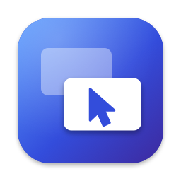
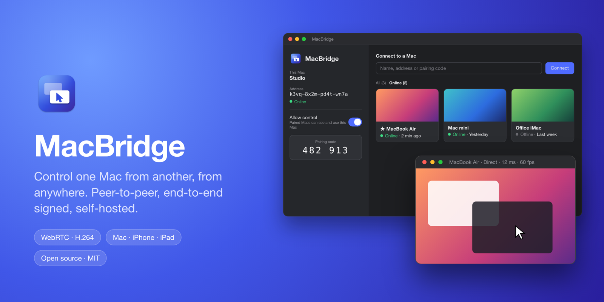
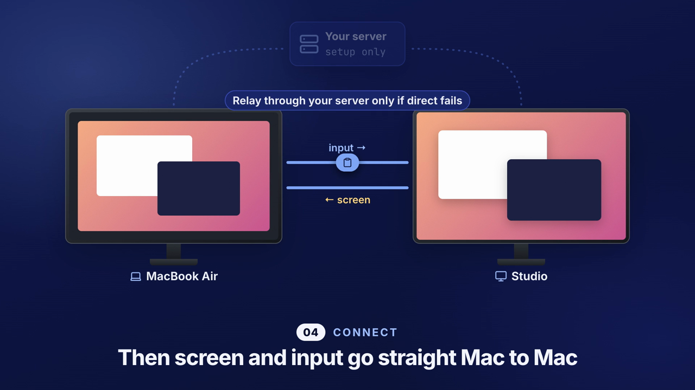
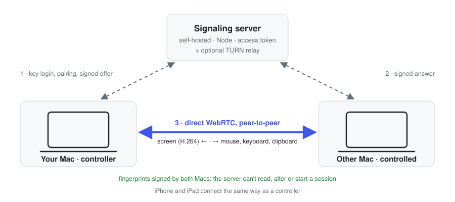

<div align="center">



# MacBridge

**Control one Mac from another, from anywhere.**<br>
Peer-to-peer screen and input over WebRTC, end-to-end signed, with a tiny server you host yourself.

[](https://github.com/habibtalib/macbridge/releases/latest)
[](https://github.com/habibtalib/macbridge/releases)
[](LICENSE)
[](#install-on-a-mac)
[](#iphone-and-ipad)
[](Packages/BridgeCore)
[](https://github.com/habibtalib/macbridge/stargazers)

[**Download**](https://github.com/habibtalib/macbridge/releases/latest) · [Install](#install-on-a-mac) · [How it works](#how-it-works) · [Self-host the server](docs/server-setup.md) · [Changelog](CHANGELOG.md)



<sub>Illustration with example Mac names.</sub>

</div>

## Why MacBridge

- 🖥️ **Your Macs, no middleman.** Video and input go straight between the two Macs; the server only introduces them.
- 🔐 **Signed end to end.** Ed25519 keys per install, one-time pairing codes, and both sides sign the connection, so the server can't read, alter or start a session.
- ⚡ **Hardware H.264.** Retina-sized screens at up to 60 fps, with Sharp, Balanced and Light presets.
- 📋 **Feels local.** Mouse, keyboard, ⌘ shortcuts, two-way clipboard, desktop switching, multiple displays.
- 😴 **Always reachable.** Opens at login, stays awake while control is allowed, even with the lid closed (via [LidAwake](https://github.com/habibtalib/lidawake)).
- 📱 **iPhone and iPad.** Touch or trackpad pointer, pinch zoom, on-screen and hardware keyboard.
- 🏠 **Self-hosted.** One Node service plus an optional TURN relay, Docker Compose included. Works great over Tailscale.

## How it works

<a href="https://github.com/habibtalib/macbridge/releases/download/v0.1.0/macbridge-how-it-works.mp4"></a>

▶ Watch the 43-second video: [how it works](https://github.com/habibtalib/macbridge/releases/download/v0.1.0/macbridge-how-it-works.mp4) (also in [docs/how-it-works.mp4](docs/how-it-works.mp4)).

<picture>
  <source media="(prefers-color-scheme: dark)" srcset="docs/images/how-it-works-dark.svg">
  
</picture>

1. Both Macs log in to your signaling server with the access token and their own key.
2. Pair once: the Mac to be controlled shows a code or QR code, the other Mac types or scans it.
3. Connecting sends a signed offer and answer through the server; then screen, input and clipboard flow directly between the Macs (relayed through TURN only when a direct path is impossible).

Status: early; used between Macs on a private network (Tailscale), not yet tried over the open internet.

## Install on a Mac

Needs macOS 15 or later on Apple silicon, on both Macs.

1. Download `MacBridge-<version>.zip` from [Releases](https://github.com/habibtalib/macbridge/releases) and double-click it to unzip.
2. Move `MacBridge.app` to `/Applications`.
3. The release is signed with a development certificate and is not notarised, so macOS blocks the first launch. Clear the download flag once in Terminal:

   ```sh
   xattr -dr com.apple.quarantine /Applications/MacBridge.app
   ```

   Or open it, click **Done** on the warning, then go to **System Settings → Privacy & Security** and click **Open Anyway**.
4. Open MacBridge and continue with [Set up](#set-up): a signaling server, then pairing.

On the Mac to be controlled, macOS asks for **Screen Recording** and **Accessibility**. Grant both in **Settings → Security**, then reopen the app. If you later replace the app with a build signed by someone else, remove MacBridge from both lists and grant again.

## Set up

1. **Server.** Follow [docs/server-setup.md](docs/server-setup.md) to run the signaling service and relay on a machine with a public IP. For a quick test on one network, run it without Docker:

   ```sh
   cd server && pnpm install && ALLOW_NO_TOKEN=1 pnpm start
   ```

2. **Both Macs.** Copy the app over (download it from Releases, or `scripts/package.sh` makes `dist/MacBridge-<version>.zip`). In **Settings (⌘,) → Connection** enter the server (`wss://bridge.example.com`, or `ws://<ip>:8787` for the quick test) and the access token, then **Go online**.
3. **The Mac to be controlled.** In the main window turn on **Allow control**. In **Settings → Security** allow Screen Recording and Accessibility, then reopen the app. In **Settings → General** turn on **Open MacBridge at login**. Back in the main window click **Show pairing code**.
4. **The Mac you control from.** Type the code into **Connect to a Mac** and click **Pair**. The Mac appears as a tile; click it to connect.

Pairing is one-way: the Mac that showed the code can be controlled by the Mac that typed it. Repeat the other way round if you want both.

## The main window

- **Left:** this Mac's name and address, whether it is online, the **Allow control** switch and the pairing code.
- **Connect to a Mac:** type a paired Mac's name or address and press Return, or type a pairing code to add a Mac.
- **Tiles:** one per Mac you can control, with a picture from the last session, a dot (green online, grey offline) and when you last connected. Right-click to rename, mark as favourite or forget. Favourites come first.
- **Menu bar icon:** **Connect to** with the same Macs (the Mac already on screen is only brought to the front), **Copy This Mac's Address** and **Show Pairing Code**. During a session it shows **Connected to** the Mac, with **Disconnect**.

## In a session

- Mouse, keyboard and scroll go to the other Mac while its screen has focus, including ⌘ shortcuts.
- The clipboards stay the same: text copied on either Mac can be pasted on the other. Text only, up to 100 KB; copies a password manager marks as private are not sent.
- **Toolbar:**
  - *Name and connection* (click for details): direct or relayed, round trip, picture size, frame rate, bit rate, packets lost.
  - *Display*: choose which of the other Mac's displays to show.
  - *View*: Fit to Window, Fill Window (may cut the edges) or Actual Size.
  - *Quality*: Sharp, Balanced or Light. The choice is kept for the next session.
  - *Actions*: previous and next desktop, Mission Control, Spotlight, switch app, send clipboard, save screenshot (to the Desktop, and copied), lock screen.
  - *Full Screen*: move the pointer to the top edge to get the toolbar back.
  - *Disconnect*.
- Control-← / Control-→, Control-↑ and ⌘Space go to the other Mac while the session window is in front, if this Mac allows MacBridge under Accessibility. Without that, use the Actions menu.
- Trackpad swipes between desktops and ⌘Tab stay on this Mac.
- Closing the window during a session asks first, then disconnects.
- If the session drops, the window offers **Reconnect**.

## On the Mac being controlled

- A small panel in the top right corner says who is in control and for how long, with **End**. The menu bar icon turns red.
- **With the lid closed** (Settings → Security, laptops only): *Sleep as usual*, *Stay reachable on the power adapter*, or *Always stay reachable*. It applies while Allow control is on and the Mac is online. The other Mac sees a virtual display, since the built-in screen is off. Staying awake needs [LidAwake](https://github.com/habibtalib/lidawake) installed: macOS only lets an administrator switch off lid-close sleep, and LidAwake holds that permission. Its battery and heat limits still apply. MacBridge turns it off again when control is switched off, the Mac goes offline or the app quits, unless you had turned LidAwake on yourself.
- **Ask first** (Settings → Security, per Mac): that Mac must be accepted on this Mac before it can connect. No answer in 30 seconds declines. Leave it off for a Mac nobody sits at.

## iPhone and iPad

`MacBridgeMobile` controls a Mac from an iPhone or iPad. It cannot be controlled itself: iOS does not allow it.

```sh
xcodegen generate
open MacBridge.xcodeproj      # choose the MacBridgeMobile scheme and your device, then Run
```

- **Set up:** in Settings (gear) enter the same server as your Macs and go online. If the server is on a private network such as Tailscale, the device has to be on it too.
- **Add a Mac:** on the Mac click **Show pairing code**, then scan its QR code with the scan button, or type the code and tap **Pair**.
- **Pointer:** two modes, switched from the bar at the top.
  - *Touch* (default on iPad): tap where you want to click, long press for a right click, drag to drag.
  - *Trackpad* (default on iPhone): drag to move the pointer, tap to click, tap then touch and drag to drag.
  - In both: two-finger tap is a right click, two-finger drag scrolls, pinch zooms the picture. While zoomed in, two fingers move the picture instead of scrolling.
- **Keyboard:** the keyboard button opens the on-screen keyboard with a bar for ⌘ ⌥ ⌃ ⇧ (held for the next key), Esc, Tab, arrows and common shortcuts. A hardware keyboard works as on a Mac. On-screen typing assumes a US keyboard layout on the Mac; characters without a key are pasted.
- **iPad with a mouse or trackpad:** the pointer, right click and scrolling go to the Mac.
- **More menu:** desktops, Mission Control, Spotlight, switch app, copy screenshot, lock, quality, connection details, and the clipboard: *Send Clipboard to Mac* and *Get Mac's Clipboard* (manual, because iOS asks for permission on every automatic read).
- Pointer mode and quality changed during a session last for that session. The defaults are in Settings.
- The screen stays on during a session. The session ends when the app goes to the background. Coming back offers to reconnect, and the call waits until the device is online again.

## Security

Each install has an Ed25519 key in the keychain; its device ID is derived from the key. The server checks the access token and that a device holds its key, and nothing more. A session starts only when a paired device sends a signed, fresh request, and both sides sign the certificate fingerprints of the encrypted connection, so the server cannot read, alter or start a session. See the end of [docs/server-setup.md](docs/server-setup.md) for what a compromised server could still do.

## Limits

- After a restart the controlled Mac is reachable only once someone has logged in. Use automatic login if it must come back unattended.
- It stays awake while control is allowed. A closed laptop sleeps unless *With the lid closed* is set (see above).
- No file transfer or audio.

## Build from source

Requires Xcode 16+, [XcodeGen](https://github.com/yonaskolb/XcodeGen), Node 24+ and pnpm.

```sh
export DEVELOPMENT_TEAM=XXXXXXXXXX   # your Apple team ID (Xcode → Settings → Accounts)
xcodegen generate
xcodebuild -project MacBridge.xcodeproj -scheme MacBridge -derivedDataPath build build
open build/Build/Products/Debug/MacBridge.app
```

Builds are signed with your development identity; `project.yml` reads the team ID from `DEVELOPMENT_TEAM`. macOS ties the Screen Recording and Accessibility grants to the signature, so do not switch to ad-hoc signing. `scripts/package.sh` makes a Release zip in `dist/`; with `NOTARY_PROFILE` and a Developer ID certificate it also notarises.

## Layout

| Path | What |
|---|---|
| `App/` | Mac app (home window, session window, settings) |
| `Mobile/` | iPhone and iPad app (controller only) |
| `Packages/BridgeCore/` | Everything else: input protocol, signaling client, WebRTC session, screen capture, input injection |
| `server/` | Signaling server (Node 24, TypeScript, `ws`) |

## Tests

```sh
cd Packages/BridgeCore && swift test   # protocol, mapping, WebRTC loopback, client ↔ real server
cd server && pnpm test && pnpm typecheck
```

The WebRTC loopback test runs a host and a controller in one process and checks hardware H.264 video and both input channels end to end. The client ↔ server tests need `server/node_modules`.

## Contributing

Issues and pull requests are welcome. Run the tests above before sending a change, and keep the README in step with what the app does.

## License

MIT. See [LICENSE](LICENSE). Changes per release are in [CHANGELOG.md](CHANGELOG.md).
